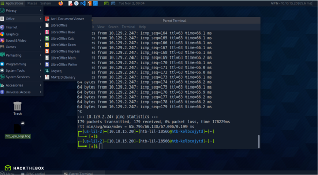

Pwnbox – Network Connectivity
Objective

Establish network connectivity to a target server within the Hack The Box environment.

Activities Performed:
   - Launched Pwnbox.
   - Connected to the HTB lab environment.
   - Performed a ping test to the target IP address (10.129.247) to verify network connectivity.
   - Transmitted 179 packets during the connectivity test.

Screenshots:  

