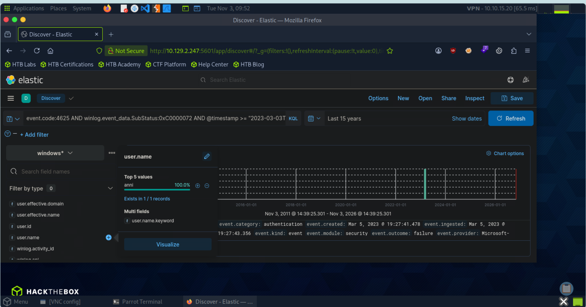
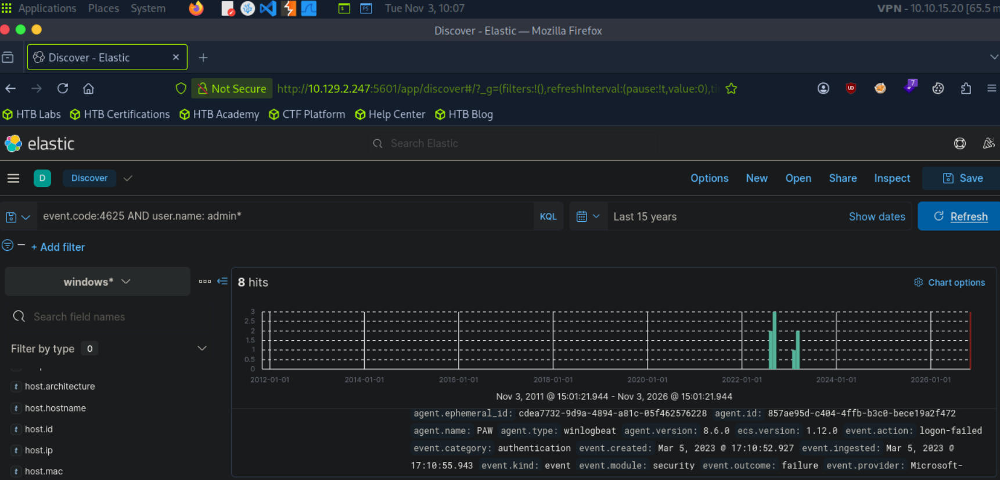

# Elasticsearch Security Monitoring

## 1. Identifying a Disabled Account Using KQL in Elastic 

I used Elastic Discover to investigate Windows Security Event ID 4625, which records failed logon attempts. I applied a KQL query to filter for authentication failures involving disabled accounts.
I examined the event details, specifically the winlog.event_data.SubStatus field (0xc0000072), which indicates that the account was disabled by an administrator.
From the event logs, I identified the disabled account username as anni, belonging to the EAGLE domain (EAGLE\anni).

Key fields investigated:
- event.code: 4625
- winlog.event_data.TargetUserName: anni
- winlog.event_data.TargetDomainName: EAGLE
- winlog.event_data.SubStatus: 0xc0000072
  
Outcome: Successfully used KQL and Windows Security event logs in Elastic to identify the username of a disabled account and understand why the authentication attempt failed.

**Screenshot:**

## 2. Performing a Wildcard Query

I performed a query using wildcard expressions to identify failed login attempts associated with administrator accounts. Specifically, I searched for event code 4625 AND user name admin* to identify failed authentication attempts involving usernames beginning with "admin." This approach helps identify potential attempts to target administrator accounts, including variations of common administrative usernames.

**Screenshot:**

